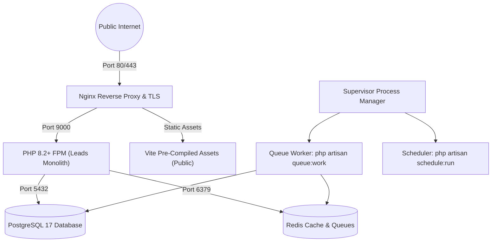

# Production Deployment & Infrastructure Guide — Leads SaaS

## 1. Overview & Architecture

Leads is container-ready and can be deployed via Docker Compose, Docker Swarm, or dedicated VPS infrastructure (e.g., Ubuntu 24.04 LTS on AWS, DigitalOcean, or Hetzner).



---

## 2. Docker & Container Strategy

### 2.1 Multi-Stage Dockerfile
- Stage 1: Build frontend assets via `node:22-alpine` (`npm run build`).
- Stage 2: Install production PHP dependencies via `composer install --no-dev --optimize-autoloader`.
- Stage 3: Alpine PHP 8.2+ runtime with `pdo_pgsql`, `redis`, `opcache`, and `gd`.

### 2.2 Docker Compose Services
- `app`: PHP-FPM application server.
- `web`: Nginx reverse proxy serving compiled static files and proxying PHP requests.
- `postgres`: PostgreSQL 17 database with persistent data volume.
- `redis`: Redis 7 Alpine for cache and queue processing.
- `queue`: Worker container running `php artisan queue:work --tries=3`.
- `scheduler`: Background container running `php artisan schedule:work`.

---

## 3. Production Environment Variables Checklist

Ensure these variables are configured in `.env` (derived from `.env.example`):
- `APP_ENV=production`
- `APP_DEBUG=false`
- `APP_URL=https://leads.yourdomain.com`
- `DB_CONNECTION=pgsql`
- `DB_HOST=postgres`
- `DB_PORT=5432`
- `DB_DATABASE=leads_production`
- `DB_USERNAME=leads_app`
- `DB_PASSWORD=<secure-database-password>`
- `CACHE_STORE=redis`
- `QUEUE_CONNECTION=redis`
- `SESSION_DRIVER=redis`
- `MAIL_MAILER=smtp`

---

## 4. Deployment Steps

```bash
# 1. Clone repository
git clone https://github.com/your-org/leads.git /var/www/leads
cd /var/www/leads

# 2. Setup environment
cp .env.example .env
nano .env # Configure secrets

# 3. Build & start containers
docker compose -f docker-compose.prod.yml up -d --build

# 4. Run migrations & seed core data
docker compose exec app php artisan migrate --force
docker compose exec app php artisan db:seed --class=ProductionSeeder --force

# 5. Cache configurations for peak speed
docker compose exec app php artisan config:cache
docker compose exec app php artisan route:cache
docker compose exec app php artisan view:cache
docker compose exec app php artisan event:cache
```

---

## 5. Backup & Disaster Recovery Strategy

1. **Automated Database Dumps:** Scheduled daily `pg_dump` compressed with GZIP, encrypted, and synced to offsite S3-compatible object storage.
2. **Point-In-Time Recovery (PITR):** PostgreSQL WAL archiving enabled for mission-critical disaster recovery.
3. **Rollback Strategy:** Blue/Green deployment or git hash tagging with instant symlink switching and zero-downtime database backward-compatible migrations.

