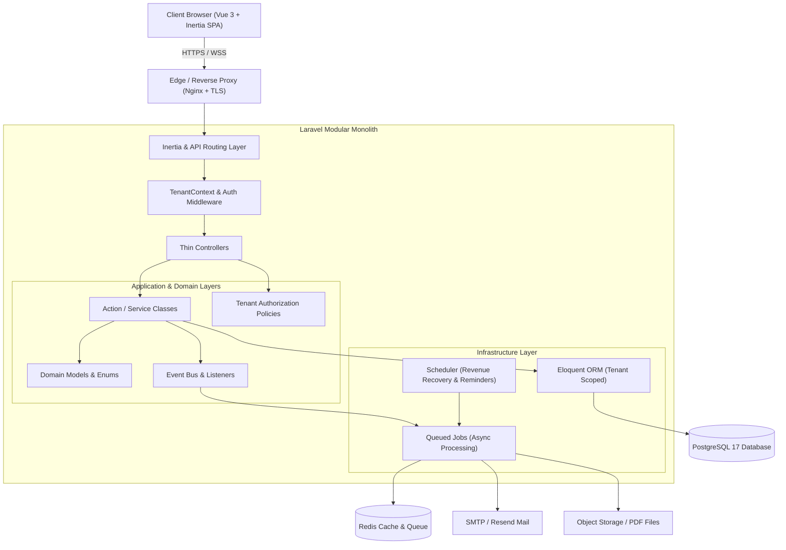
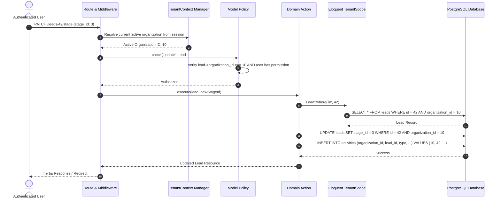

# System Architecture — Leads SaaS

## 1. Architectural Philosophy

**Leads** is designed as a **Modular Monolithic Architecture** engineered for high developer velocity, strict multi-tenant data isolation, clean domain boundaries, and production maintainability.

Rather than prematurely fragmenting into microservices with distributed transaction overhead, Leads organizes core business capabilities into well-bounded domain modules within a unified Laravel 11/12 application using Vue.js 3 and Inertia.js for a seamless single-page application (SPA) experience without API duplication.

---

## 2. Layered Responsibilities

The application strictly separates concerns across five architectural tiers:

### 2.1 Presentation Tier (Frontend)

- **Framework:** Vue.js 3 (Composition API with `<script setup lang="ts">`).
- **Bridge:** Inertia.js (eliminates the need for client-side state duplication or manual REST fetching for core views while preserving full SPA snappiness).
- **Styling & Design Tokens:** Tailwind CSS configured with the Leads brand palette:
  - Dark Indigo (`#280047`) — primary brand & navigation
  - Red Orange (`#F74D01`) — call-to-actions, primary highlights
  - Light Purple (`#C3B6D3`) — secondary borders & subtle surfaces
  - Light Yellow (`#FDFEBA`) — soft badge backgrounds, status highlights
  - Main White (`#FFFFFF`) — card backgrounds & canvas
  - Dark Gray (`#242424`) — readable typography
- **State Management:** Inertia page props for server-hydrated state; Pinia stores reserved strictly for ephemeral UI state (e.g. sidebar collapse, active modal overlays, kanban drag states).
- **Icons:** Lucide Vue Next.

### 2.2 HTTP & Routing Tier

- **Controllers:** Kept strictly thin. Responsible solely for HTTP request reception, Form Request validation delegation, invocation of Domain Actions, and returning Inertia responses or API resources.
- **Middleware:**
  - `AuthenticateSession`: Standard secure session-based authentication.
  - `ResolveTenantContext`: Identifies current active organization from session/subdomain/header, verifies user membership, sets tenant context in container.
  - `EnsureTenantSubscription`: Enforces active subscription status or trial limits.
  - `VerifyOrganizationRole`: Guards routes based on role capabilities (`Owner`, `Admin`, `Manager`, `Sales`).

### 2.3 Application & Action Tier

- Every critical business workflow is encapsulated into single-responsibility Action classes:
  - `CreateLeadAction`
  - `TransitionLeadStageAction`
  - `ScheduleFollowUpAction`
  - `GenerateQuotationPdfAction`
  - `CalculateQuotationTotalAction`
  - `EvaluateRevenueRecoveryAction`
- Actions run within database transactions (`DB::transaction`) to guarantee ACID compliance for multi-record operations (e.g. stage transition logging activity + updating lead + refreshing recovery metrics).

### 2.4 Domain Tier

- **Models:** Eloquent models implementing the `BelongsToOrganization` trait.
- **Enums:** Native PHP 8.2+ backed enums (`LeadPriority`, `QuotationStatus`, `ActivityType`, `MemberRole`, `Currency`).
- **Policies:** Explicit authorization policies (`LeadPolicy`, `QuotationPolicy`, `OrganizationPolicy`) verifying both tenant boundaries and RBAC permissions.

### 2.5 Infrastructure Tier

- **Database:** PostgreSQL 17 utilizing JSONB for flexible lead custom fields and quotation snapshots, native UUID/BigInteger primary keys, and composite indexes `(organization_id, ...)`.
- **Queues:** Redis/Database driver handling email delivery, PDF compilation, and periodic recovery rule evaluations.
- **Scheduler:** Automated cron triggers checking overdue follow-ups, expiring quotes, and inactive leads.

---

## 3. Multi-Tenancy Isolation Architecture

Leads adopts the **Shared Database, Shared Schema with Logical Row-Level Isolation** strategy, powered by:

1. Every tenant-owned table features a non-nullable `organization_id` foreign key with cascade deletion.
2. An Eloquent Global Scope (`TenantScope`) automatically injects `WHERE organization_id = :current_org_id` on all model queries.
3. The `BelongsToOrganization` trait hooks into `creating` events to automatically populate `organization_id` from the resolved tenant context.
4. Authorization policies reject any request where `model->organization_id !== tenantContext->id`.
5. Background jobs serialize tenant context to guarantee jobs run within the tenant's isolation perimeter.

---

## 4. Module Decomposition

| Module                               | Core Responsibility                                       | Key Models                                               |
| ------------------------------------ | --------------------------------------------------------- | -------------------------------------------------------- |
| **Identity & Access**          | Authentication, Sessions, Password Recovery, Profiles     | `User`, `PersonalAccessToken`                        |
| **Organizations & Workspaces** | Tenants, Invitations, Memberships, Subscriptions          | `Organization`, `OrganizationMember`, `Invitation` |
| **Lead Management**            | Capture, Validation, Deduplication, Tagging, Assignment   | `Lead`, `LeadSource`, `LeadTag`                    |
| **Sales Pipeline**             | Visual Stages, Kanban Ordering, Stage Transitions         | `PipelineStage`, `PipelineTransition`                |
| **Activities & Follow-ups**    | Timeline logging (calls, meetings, notes) & reminders     | `Activity`, `FollowUp`                               |
| **Quotation Engine**           | Line items, multi-currency, taxes, PDF generation, tokens | `Quotation`, `QuotationItem`                         |
| **Revenue Recovery**           | Rule engine for stalled leads, expiring quotes, alerts    | `RecoveryRule`, `RecoveryAlert`                      |
| **Analytics & Reporting**      | Conversion rates, won revenue, agent performance          | Computed projections / materialized views                |
| **Audit Logging**              | Security audit trails for all sensitive tenant actions    | `AuditLog`                                             |

---

## 5. Security & DevSecOps Strategy

- **Tenant Boundary Defense:** Direct Object Reference (IDOR) attacks are blocked at both database scope and policy level.
- **XSS & Content Security:** Inertia and Vue auto-escape outputs; strict Content Security Policy headers in Nginx/Laravel.
- **CSRF Protection:** Laravel's session-based encrypted CSRF token verification on all mutation requests.
- **Financial Calculations:** All monetary figures stored as integers in minor currency units (cents) or PostgreSQL `DECIMAL(14, 2)`. Floating-point math is strictly forbidden.
- **Signed URLs:** Public quotation links utilize cryptographically signed tokens (`URL::temporarySignedRoute`) preventing enumeration.
